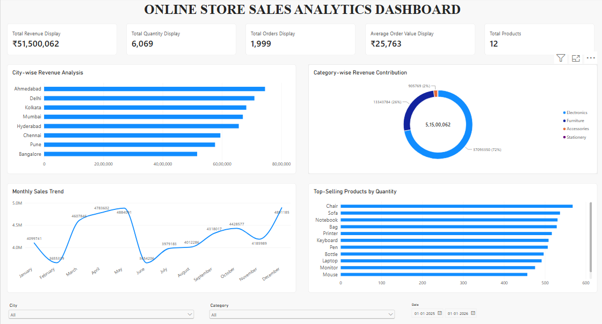
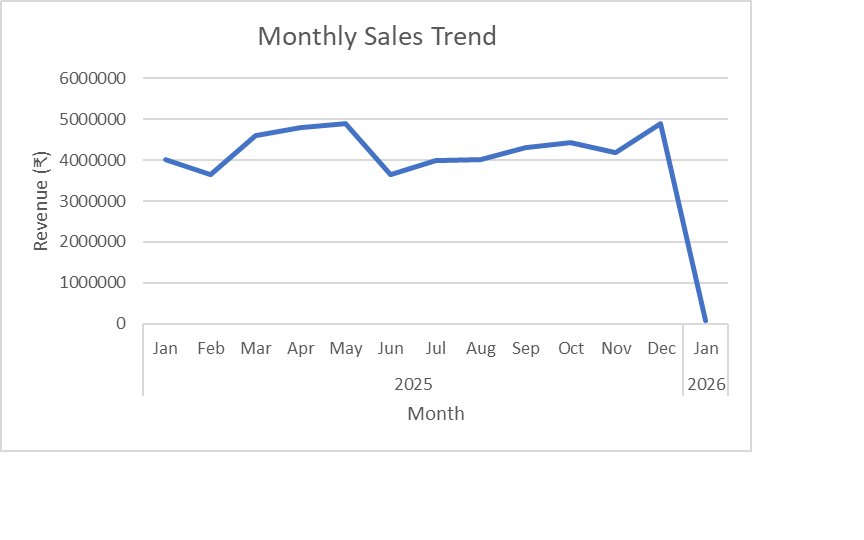
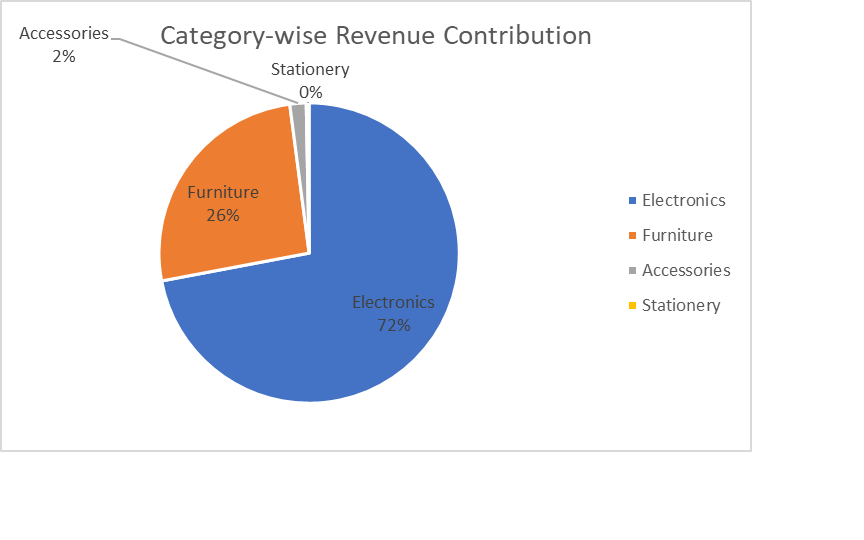

# Online Store Sales Data Analytics

## Project Overview

This project focuses on analyzing online store sales data to identify sales trends, product performance, category-wise revenue and city-wise business performance.

The objective is to transform raw sales data into meaningful business insights and recommendations using Python, Microsoft Excel and Power BI.

## Project Objectives

- Load and explore the sales dataset.
- Clean and preprocess the data.
- Perform exploratory data analysis (EDA).
- Calculate total revenue and other sales metrics.
- Identify the best-selling products and top-performing cities.
- Analyze category-wise and monthly sales performance.
- Create meaningful visualizations and an interactive dashboard.
- Provide data-driven business recommendations.

## Tools and Technologies

- **Python**
- **Pandas** – Data cleaning and analysis
- **Matplotlib** – Data visualization
- **Microsoft Excel** – PivotTables and PivotCharts
- **Power BI** – Interactive dashboard

## Dataset Description

The dataset contains online store sales records with the following columns:

- Order_ID
- Date
- Product
- Category
- City
- Quantity
- Price
- Revenue (calculated during data processing)

## Project Workflow

### 1. Data Loading
Loaded the sales dataset using Pandas and explored its structure.

### 2. Data Cleaning
- Handled missing values.
- Removed duplicate records.
- Removed unwanted spaces from text columns.
- Converted the Date column into datetime format.

### 3. Data Processing

Created a new Revenue column using:

`Revenue = Quantity × Price`

### 4. Exploratory Data Analysis

Analyzed:
- Product-wise sales.
- City-wise revenue.
- Category-wise revenue.
- Monthly sales trends.
- Average Order Value.

### 5. Data Visualization

Created charts using Matplotlib to understand sales performance and trends.

### 6. Excel Analysis

Created PivotTables and PivotCharts to summarize sales data.

### 7. Power BI Dashboard

Developed an interactive dashboard containing KPI cards, sales charts and slicers for exploring the data.

## Key Business Insights

- **Total Revenue:** ₹5,15,00,062
- **Total Quantity Sold:** 6,069
- **Total Orders:** 1,999
- **Average Order Value:** ₹25,763
- **Total Products:** 12
- **Best-Selling Product:** Chair
- **Best-Performing City:** Ahmedabad
- **Highest Revenue Category:** Electronics

## Business Recommendations

- Focus on high-performing products to improve sales.
- Develop targeted marketing strategies for different cities.
- Promote high-revenue product categories.
- Monitor monthly sales trends to identify opportunities.
- Improve inventory planning based on product demand.

## Project Screenshots

### Power BI Dashboard



### Excel Monthly Sales Trend



### Excel Category Revenue



## Project Structure

```text
Online-Store-Sales-Analysis/
│
├── data/
│   ├── sales_data_2000_rows (2).xlsx
│   └── sales_data_cleaned.csv
│
├── notebooks/
│   └── Online_Store_Sales_Analysis.ipynb
│
├── charts/
│   ├── revenue_by_city.png
│   ├── category_contribution.png
│   └── monthly_sales_trend.png
│
├── images/
│   ├── powerbi_dashboard.png
│   ├── excel_monthly_sales.png
│   └── excel_category_revenue.png
│
├── excel/
│   └── Online_Store_Sales_Analysis.xlsx
│
├── powerbi/
│   └── Online_Store_Sales_Analysis_Dashboard.pbix
│
├── README.md
└── .gitignore
```

## Conclusion

This project demonstrates the use of Python, Excel and Power BI to clean, analyze and visualize online store sales data. The analysis provides useful insights into product performance, revenue distribution and monthly sales trends, helping businesses make informed decisions.

## Author

**Lakshmi Rupanjali Gongati**

B.Tech – Computer Science and Engineering (2026)